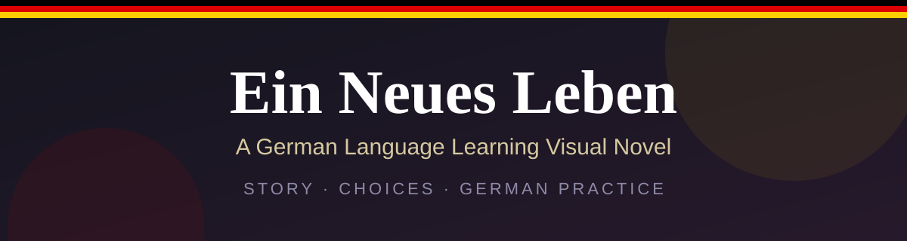
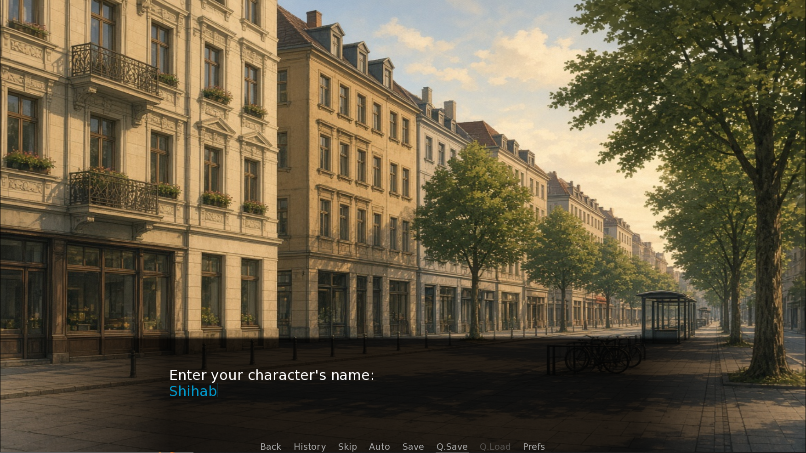

 

**Learn German through a story you shape with your own choices.**

[Overview](#-overview) · [Features](#-key-features) · [Screenshots](#-screenshots) · [Status](#-project-status) · [Contact](#-contact)

---

## 📖 Overview

**Ein Neues Leben** ("A New Life") is a visual novel project that combines interactive storytelling with German language learning. Players explore a story through dialogue and choices while practising German in an engaging environment.

| | |
| --- | --- |
| **Project type** | Interactive software project |
| **Developer** | Md Shihab Hossain |
| **University** | Bangladesh University of Business and Technology (BUBT) |
| **Department** | Computer Science and Engineering |
| **Status** | In development |

## 🎯 Objectives

- Make German language learning more interactive.
- Combine storytelling with language practice.
- Encourage vocabulary development through gameplay.

## ✨ Key Features

| | Feature |
| --- | --- |
| 📚 | Visual novel storytelling |
| 💬 | Character dialogue and player choices |
| 🇩🇪 | German language learning content |
| 💾 | Save and load functionality |
| 🔊 | Audio support, including pronunciation, where available |

## 🛠️ Technology Stack

| Tool | Purpose |
| --- | --- |
| **Ren'Py** | Visual novel engine |
| **Python scripting** | Game logic, where applicable |
| **GitHub** | Project documentation and version control |

## 🖼️ Screenshots

<table>
  <tr>
    <td align="center" width="50%">
      
       <b>Main Window</b>
    </td>
    <td align="center" width="50%">
      
       <b>Start Screen</b>
    </td>
  </tr>
  <tr>
    <td align="center" width="50%">
      
       <b>Character Dialogue</b>
    </td>
    <td align="center" width="50%">
      
       <b>German Learning Screen</b>
    </td>
  </tr>
  <tr>
    <td align="center" width="50%">
      
       <b>Player Choice Screen</b>
    </td>
    <td align="center" width="50%">
      
       <b>Save and Load Screen</b>
    </td>
  </tr>
</table>

## 🎬 Demo

The game is available to play and download on itch.io:

## 🚧 Project Status

The project is under development. Features and learning content may change as development continues.

## 🔒 Source Code

The main source repository is private. This public repository provides project documentation and selected screenshots.

## 🗺️ Future Improvements

- [ ] Expand German vocabulary and dialogue.
- [ ] Improve pronunciation audio.
- [ ] Test usability and learning experience.
- [ ] Add more interactive learning activities.

## 📬 Contact

**Md Shihab Hossain**

---

© Md Shihab Hossain. All rights reserved.

